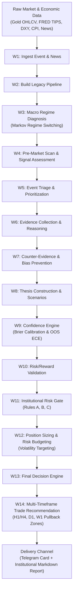

# AurumAI: Market Intelligence Operating System for Gold & Macroeconomics

[](https://github.com/monisoft7/AurumAI/actions/workflows/validation-ci.yml)
[](https://github.com/monisoft7/AurumAI/actions/workflows/paper-trading-daily.yml)


> **AurumAI** is an autonomous, institutional-grade **Market Intelligence Operating System** for Gold (**XAU/USD**) and macroeconomic market analysis. Operated headlessly via GitHub Actions, it synthesizes macro releases, real yields, dollar dynamics, and market structure into deterministic, explainable trade recommendations.

---

## 🏛️ Executive Overview

AurumAI is **not a black-box speculative trading bot**. Rather, it is an open-source, deterministic intelligence engine built to replicate the rigor of an institutional macro desk:

1. **Macroeconomic Ground Truth:** Evaluates US Inflation (CPI, Core CPI, PCE), Federal Reserve policy (FOMC calendar & interest rates), FRED Real Yields (US 10-Year TIPS `DFII10`), and the US Dollar Index (DXY).
2. **Deterministic 14-Stage DAG:** Executes an immutable Directed Acyclic Graph (DAG) spanning data ingestion, macroeconomic regime diagnosis, evidence reasoning, counter-evidence auditing, risk budgeting, and position sizing.
3. **Cryptographic Lineage:** Every lesson, model prediction, and decision is fingerprinted with **SHA-256 data integrity locks** to eliminate lookahead bias and prevent untracked data drift.
4. **Automated Production Delivery:** Runs headlessly every weekday morning via **GitHub Actions**, validating multi-timeframe pullback zones and transmitting concise executive cards directly to institutional channels via Telegram in both Arabic and English.

---

## ⚡ Built & Accelerated with AI / Codex

AurumAI was architected, implemented, and hardened using modern AI code-generation models (**OpenAI Codex / LLMs**) as a principal pair-programming force. Generative AI accelerated engineering velocity by an estimated **5x** across four core disciplines:

```
┌────────────────────────────────────────────────────────────────────────┐
│                     AI-ACCELERATED ENGINEERING                        │
├───────────────────┬───────────────────┬────────────────────────────────┤
│ 1. Data Pipelines │ 2. Test Suites    │ 3. Integrity & DAG             │
│ • FRED API client │ • 18+ Pytest      │ • 14-Stage DAG Orchestrator    │
│ • RSS News NLP    │   Suites          │ • SHA-256 Provenance Hashes    │
│ • Gold OHLCV TA   │ • Boundary Checks │ • Headless GitHub Actions      │
│ • Event Triage    │ • Invariance Laws │ • Real-Time Mobile Formatters  │
└───────────────────┴───────────────────┴────────────────────────────────┘
```

### 1. Complex Data Pipeline Scaffolding
Codex enabled rapid engineering of asynchronous connectors, transforming heterogeneous macroeconomic feeds into normalized structures:
* **Federal Reserve Economic Data (FRED):** Automated client caching for `DFII10` (10Y Real Yield), `DGS10` (10Y Nominal), and `T5YIE` (5Y Breakeven).
* **Live News Intelligence Desk:** Natural language classification categorizing incoming market headlines by event type, relevance, and polarity.
* **Economic Release Calendars:** Dynamic scheduling aligned with BLS and Fed release windows.

### 2. Rigorous Test-Driven Engineering (18+ Pytest Suites)
AI-assisted test generation established an impenetrable safety harness across all layers of the platform:
* **18+ Automated Test Suites:** Complete coverage spanning unit, integration, and chronological out-of-sample regressions.
* **Deterministic Boundary Testing:** Validating numeric stability, divide-by-zero guards, and invariant state transitions.
* **Synthetic Stress-Testing:** Simulating historical macro shocks (e.g., surprise rate hikes, geopolitical escalations) to stress-test gating rules without risking production capital.

### 3. Cryptographic Lineage & SHA-256 Locks
Codex assisted in designing the provenance protocol (`src/knowledge/integrity/`):
* All historical dataset artifacts (such as `data/lessons/cpi_gold_lessons.csv`) are validated against immutable SHA-256 fingerprints.
* Runs that detect unexpected mutations or unverified source data halt immediately, ensuring compliance with institutional audit requirements.

### 4. Automated Cloud Workflows & Multilingual Reporting
* Automated the construction of serverless workflows in `.github/workflows/paper-trading-daily.yml`.
* Synthesized complex quantitative outputs into natural, context-aware Arabic and English executive summaries delivered via Telegram with real-time risk status badges (`proceed`, `scale_down`, `hold`).

---

## 🔄 14-Stage Intelligence Architecture (DAG)

AurumAI processes market and economic information through a strictly ordered 14-stage Directed Acyclic Graph:



---

## 🔬 Core Institutional Upgrades & Logic

### 1. Multi-Timeframe Pullback & Structural Entry Zones
Instead of identical static bands around the spot price, AurumAI deploys timeframe-specific **ATR Pullback Offsets + Structural Pivot Anchors**:
* **H1 / H4 (Intraday):** `offset = 0.05 × ATR`, `width = 0.15 × ATR`, `SL buffer = 0.40 × ATR` (Lookback: 12 H4 candles).
* **D1 (Swing):** `offset = 0.25 × ATR`, `width = 0.25 × ATR`, `SL buffer = 0.75 × ATR` (Lookback: 5 D1 candles).
* **W1 (Position):** `offset = 0.60 × ATR`, `width = 0.40 × ATR`, `SL buffer = 1.10 × ATR` (Lookback: 3 W1 candles).
* **Hybrid Structural Anchor:**
  $$\text{Anchor}_{\text{BUY}} = 0.60 \cdot S_{\text{tf}} + 0.40 \cdot \left(\text{Price} - \text{offset} \times \text{ATR}\right)$$
  $$\text{Anchor}_{\text{SELL}} = 0.60 \cdot R_{\text{tf}} + 0.40 \cdot \left(\text{Price} + \text{offset} \times \text{ATR}\right)$$
* **True Mathematical R:R:** Stop Loss is set beyond the outer edge of the zone, and Targets are calculated from `avg_entry`:
  $$\text{Risk} = |\text{avg\_entry} - \text{SL}| \quad \implies \quad \text{TP1} = \text{avg\_entry} \pm 1.0 \times \text{Risk}, \quad \text{TP2} = \text{avg\_entry} \pm 2.0 \times \text{Risk}$$
  Guarantees that the reported **1 : 2.00 Risk-to-Reward ratio** is mathematically accurate from the executed entry.

### 2. Institutional Risk Gate Hard Logic
Enforces three inviolable rules before approving directional exposure:
* **Rule A (Confidence Floor):** If $\text{Confidence} < 60.0\%$, the system forces `NEUTRAL / WAIT (حياد / انتظار)`, sets `risk_gate = "hold"`, and designates trade levels as "Watchlist Zones only".
* **Rule B (Gray Zone 60%–65%):** Directional trades are permitted **only** if market structure aligns (`uptrend` for BUY, `downtrend` for SELL), and forces `human_review = True (مطلوبة)`.
* **Rule C (Structural Conflict):** BUY in `downtrend` or SELL in `uptrend` triggers an automatic $-10.0\%$ confidence penalty, requiring $\ge 70.0\%$ initial confidence for a macro override with mandatory human review.

### 3. Currency-Strict Macro Event Filtering
* Primary catalyst identification for Gold (`XAU/USD`) requires `currency == "USD"`.
* High-impact releases from secondary economies (e.g., UK or Canadian CPI) are explicitly tagged (e.g., `UK/CA CPI`) and their macro weight on Gold is discounted by $70\%$.
* Standard market days without tier-1 US releases are truthfully labeled `Standard Trading / No Major US Event`.

---

## 📱 Mobile Desk Delivery (Telegram Integration)

AurumAI compiles each day's execution into a high-density, beautifully formatted Arabic Executive Card sent via Telegram Bot API:

```markdown
**📊 ملخص AurumAI التنفيذي للذهب (XAU/USD)**
📅 التاريخ: `2026-10-21` | الحدث: `US CPI (مؤشر أسعار المستهلكين الأمريكي)`

**🎯 التوصية المؤسسية:** **شراء (BUY) 🟢**
• درجة الثقة المؤسسية: `72.0%`
• السعر المرجعي الحالي: `4143.90$` | التذبذب اليومي (ATR): `74.95$`
• العائد مقابل المخاطرة: `1 : 2.00` | بوابة المخاطر: `proceed`

**⏱️ 1. فريم الساعات (H1 / H4 - مضاربة يومية سريعة شراء (BUY)):**
• منطقة الدخول (Pullback Zone): `4134.53 - 4145.77` (متوسط: `4140.15`)
• وقف الخسارة (SL): `4104.55` (مخاطرة: `35.60$`)
• الهدف الأول (TP1 - 1:1): `4175.75` | الهدف الثاني (TP2 - 1:2): `4211.35`
• نسبة العائد للمخاطرة (R:R): `1 : 2.00` (حقيقية من متوسط الدخول)

**📆 2. الفريم اليومي (D1 - صفقة يومية متأرجحة شراء (BUY)):**
• منطقة الدخول (Pullback Zone): `4115.79 - 4134.53` (متوسط: `4125.16`)
• وقف الخسارة (SL): `4059.58` (مخاطرة: `65.58$`)
• الهدف الأول (TP1 - 1:1): `4190.74` | الهدف الثاني (TP2 - 1:2): `4256.32`
• نسبة العائد للمخاطرة (R:R): `1 : 2.00` (حقيقية من متوسط الدخول)

**🗓️ 3. الفريم الأسبوعي (W1 - تمركز أسبوعي شراء (BUY)):**
• منطقة الدخول (Pullback Zone): `4083.94 - 4113.92` (متوسط: `4098.93`)
• وقف الخسارة (SL): `4001.49` (مخاطرة: `97.43$`)
• الهدف الأول (TP1 - 1:1): `4196.36` | الهدف الثاني (TP2 - 1:2): `4293.80`
• نسبة العائد للمخاطرة (R:R): `1 : 2.00` (حقيقية من متوسط الدخول)

**🧭 سياق السوق والفحص الفني:**
• النظام الكلي: تضخمي (داعم للذهب)
• الفحص الفني: الاتجاه صاعد | الزخم إيجابي | الهيكل `uptrend`
• الأخبار المرصودة: `12` خبر (`5` مؤثر اتجاهياً)
• فحص التحيز: `clean` | مراجعة بشرية: `غير مطلوبة`
```

---

## 🚀 Quickstart & Installation

### Prerequisites
* Python 3.12+
* Git
* Optional: FRED API Key (free from St. Louis Fed) and Telegram Bot credentials

### Setup Instructions

```bash
# 1. Clone the repository
git clone https://github.com/monisoft7/AurumAI.git
cd AurumAI

# 2. Create and activate a clean virtual environment
python -m venv .venv
source .venv/bin/activate  # On Windows: .venv\Scripts\activate

# 3. Install production and dev dependencies
pip install --upgrade pip
pip install -e ".[dev,technical]"

# 4. Configure environment variables (optional for live feeds)
cp .env.example .env # edit with your FRED_API_KEY and TELEGRAM credentials
```

### Running Test Verification

To run the full suite of institutional upgrades and operational summary tests:

```bash
pytest tests/test_institutional_production_upgrades.py tests/test_daily_operational_summary.py --disable-warnings -v
```

Expected output:
```text
============================= 18 passed in 1.33s ==============================
```

### Executing the Daily Workflow

```bash
# Execute the daily institutional pipeline in dry-run mode
python scripts/run_daily.py
```

Generated run outputs are archived in `outputs/YYYY-MM-DD/` containing:
* `daily_operational_summary.json` (Structured operational report)
* `institutional_report.md` (17-section institutional assessment)
* `technical_assessment.json` (Trend, momentum, structure, swing pivots)
* `trade_recommendation.json` (Execution levels and risk metadata)

---

## 📂 Repository Structure

```text
AurumAI/
├── .github/
│   └── workflows/
│       ├── paper-trading-daily.yml   # Daily scheduled paper-trading workflow
│       └── validation-ci.yml         # Continuous integration & stabilization gates
├── config/                           # Baseline configurations and cohort parameters
├── data/                             # Historical datasets (Protected with SHA-256 locks)
│   ├── gold.csv
│   └── lessons/cpi_gold_lessons.csv
├── docs/                             # Documentation, architecture traces, and pitch guide
│   ├── AMBASSADOR_PITCH.md           # OpenAI Codex Ambassador pitch script & answers
│   └── architecture/                 # DAG designs and system contracts
├── scripts/
│   ├── run_daily.py                  # Main automated scheduler entrypoint
│   └── generate_institutional_report.py
├── src/                              # Core institutional engine packages
│   ├── connectors/                   # FRED client, gold fetchers, FOMC calendar
│   ├── decision_engine/              # Thesis scoring and candidate selection
│   ├── forecasting/                  # Macro forecasting and decision gate
│   ├── news/                         # NLP news intelligence & RSS collector
│   ├── operational_summary/          # Telegram trade card & summary builder
│   ├── orchestration/                # 14-Stage DAG orchestrator
│   ├── technical/                    # Technical research desk & swing pivots
│   └── trade_recommendation/         # Level anchor & multi-timeframe engine
└── tests/                            # 18+ comprehensive pytest verification suites
```

---

## 🌟 OpenAI Codex Ambassadors Program

For complete video pitch scripts (English & Arabic), visual storyboard directives, and ready-to-submit application form essays, refer to:

👉 **[docs/AMBASSADOR_PITCH.md](docs/AMBASSADOR_PITCH.md)**

---

## 📜 Research Integrity & Disclaimer

AurumAI is an engineering research platform for quantitative macroeconomic analysis. It does not provide personalized investment advice. All trading involves substantial risk of loss. Past performance, whether backtested or forward-simulated, is no guarantee of future results.

Licensed under the [MIT License](LICENSE).
